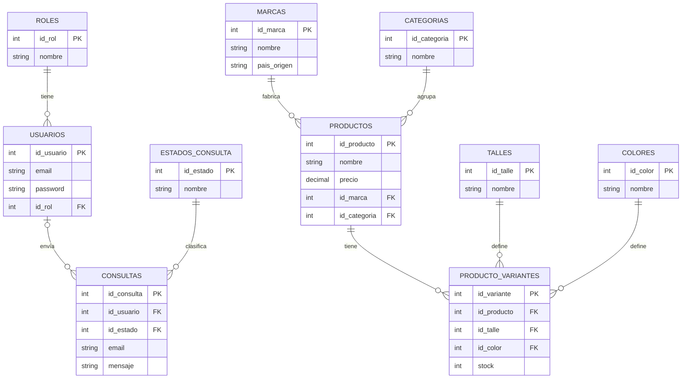

# 🗄️ TP6 – Normalización y Base de Datos del Proyecto ModaHup

Sistema: **Catálogo de Tiendas de Ropa Deportiva y Urbana** (Nike, Adidas, Zara).
Base de datos: `tienda_ropa` (el mismo nombre configurado en `env.php`).

---

## Parte 1 – Normalización

### 1. Entidad principal sin normalizar

Registro hipotético del catálogo, donde un producto guarda en una sola fila su marca, su categoría y listas de talles y colores:

| id_producto | nombre_producto | marca | pais_marca | sitio_web_marca | categoria | descripcion_categoria | talles | colores | precio |
|---|---|---|---|---|---|---|---|---|---|
| 1 | Zapatillas Air Max 90 | Nike | Estados Unidos | https://www.nike.com | Calzado deportivo | Zapatillas y sneakers para entrenamiento y uso urbano | 39, 40 | Negro, Blanco | 150000 |
| 2 | Zapatillas Pegasus | Nike | Estados Unidos | https://www.nike.com | Calzado deportivo | Zapatillas y sneakers para entrenamiento y uso urbano | 40, 41 | Negro | 140000 |
| 3 | Camisa de Lino | Zara | España | https://www.zara.com | Camisas y remeras | Prendas superiores casuales y deportivas | S, M | Azul | 45000 |

**Problemas detectados:**
- **Campos multivalorados:** `talles` y `colores` guardan varios valores en un solo campo (`39, 40` / `Negro, Blanco`).
- **Información redundante:** `pais_marca` y `sitio_web_marca` se repiten en cada producto Nike; lo mismo ocurre con `descripcion_categoria`.
- **Anomalías:** si Nike cambia su sitio web hay que modificar muchas filas (actualización); si se borra el último producto de una marca se pierde la información de la marca (borrado).

---

### 2. Proceso de normalización

#### Primera Forma Normal (1FN)

**Regla:** cada campo debe ser atómico (un solo valor) y no debe haber grupos repetitivos.

Se separan los talles y colores en filas individuales: una fila por cada combinación **producto + talle + color**. La clave pasa a ser compuesta: **(id_producto, talle, color)**.

Ejemplo con el producto 1:

| id_producto | talle | color | nombre_producto | marca | pais_marca | sitio_web_marca | categoria | descripcion_categoria | precio |
|---|---|---|---|---|---|---|---|---|---|
| 1 | 39 | Negro  | Zapatillas Air Max 90 | Nike | Estados Unidos | https://www.nike.com | Calzado deportivo | Zapatillas y sneakers para entrenamiento y uso urbano | 150000 |
| 1 | 39 | Blanco | Zapatillas Air Max 90 | Nike | Estados Unidos | https://www.nike.com | Calzado deportivo | Zapatillas y sneakers para entrenamiento y uso urbano | 150000 |
| 1 | 40 | Negro  | Zapatillas Air Max 90 | Nike | Estados Unidos | https://www.nike.com | Calzado deportivo | Zapatillas y sneakers para entrenamiento y uso urbano | 150000 |
| 1 | 40 | Blanco | Zapatillas Air Max 90 | Nike | Estados Unidos | https://www.nike.com | Calzado deportivo | Zapatillas y sneakers para entrenamiento y uso urbano | 150000 |

Ahora todos los campos son atómicos, pero aparece mucha repetición (se resuelve en 2FN y 3FN).

#### Segunda Forma Normal (2FN)

**Regla:** estar en 1FN y que ningún atributo no-clave dependa solo de una **parte** de la clave compuesta.

Clave: `(id_producto, talle, color)`.

- `nombre_producto`, `marca`, `pais_marca`, `sitio_web_marca`, `categoria`, `descripcion_categoria` y `precio` dependen **solo de `id_producto`** → dependencia parcial.
- Lo que depende de la clave completa es la disponibilidad de cada combinación (el **stock** de cada talle y color).

**Descomposición:**

**PRODUCTO** (`id_producto` PK)

| id_producto | nombre_producto | marca | pais_marca | sitio_web_marca | categoria | descripcion_categoria | precio |
|---|---|---|---|---|---|---|---|
| 1 | Zapatillas Air Max 90 | Nike | Estados Unidos | https://www.nike.com | Calzado deportivo | Zapatillas y sneakers... | 150000 |
| 2 | Zapatillas Pegasus | Nike | Estados Unidos | https://www.nike.com | Calzado deportivo | Zapatillas y sneakers... | 140000 |
| 3 | Camisa de Lino | Zara | España | https://www.zara.com | Camisas y remeras | Prendas superiores... | 45000 |

**VARIANTE** (`id_producto`, `talle`, `color` PK compuesta)

| id_producto | talle | color | stock |
|---|---|---|---|
| 1 | 39 | Negro  | 10 |
| 1 | 39 | Blanco | 5 |
| 1 | 40 | Negro  | 8 |
| 3 | S  | Azul   | 12 |

#### Tercera Forma Normal (3FN)

**Regla:** estar en 2FN y que no existan dependencias **transitivas** (un atributo no-clave que dependa de otro atributo no-clave).

En la tabla PRODUCTO:
- `id_producto → marca → pais_marca, sitio_web_marca` (transitiva) → se extrae la tabla **MARCAS**.
- `id_producto → categoria → descripcion_categoria` (transitiva) → se extrae la tabla **CATEGORIAS**.

En VARIANTE, los talles y colores se repiten como texto, por lo que se pasan a sus propias tablas **TALLES** y **COLORES** y se referencian con claves foráneas.

Además, para el resto del sistema:
- El **rol** de cada usuario se guarda en una tabla aparte (**ROLES**), evitando repetir el texto "administrador" o "cliente".
- El **estado** de cada consulta de contacto se guarda en **ESTADOS_CONSULTA**.

**Resultado:** marca y categoría quedan escritas una sola vez; si Nike cambia su sitio web, se modifica una única fila.

---

### 3. Listado de tablas resultante

| Tabla | Clave primaria (PK) | Claves foráneas (FK) | Descripción |
|---|---|---|---|
| `roles` | `id_rol` | — | Roles de usuario |
| `usuarios` | `id_usuario` | `id_rol` → `roles.id_rol` | Usuarios con email, password y datos personales |
| `marcas` | `id_marca` | — | Marcas (Nike, Adidas, Zara) |
| `categorias` | `id_categoria` | — | Categorías de indumentaria |
| `talles` | `id_talle` | — | Talles disponibles |
| `colores` | `id_color` | — | Colores disponibles |
| `estados_consulta` | `id_estado` | — | Estados de una consulta |
| `productos` | `id_producto` | `id_marca` → `marcas.id_marca` `id_categoria` → `categorias.id_categoria` | Tabla principal de negocio |
| `producto_variantes` | `id_variante` (con `UNIQUE` en `id_producto + id_talle + id_color`) | `id_producto` → `productos.id_producto` `id_talle` → `talles.id_talle` `id_color` → `colores.id_color` | Detalle / relación N:M con el stock |
| `consultas` | `id_consulta` | `id_usuario` → `usuarios.id_usuario` (opcional) `id_estado` → `estados_consulta.id_estado` | Mensajes del formulario de contacto |

### Diagrama entidad-relación

---

## Parte 2 y 3 – Scripts SQL

- [`schema.sql`](schema.sql): creación de la base de datos, tablas, claves foráneas, campos de auditoría e índices.
- [`consultas.sql`](consultas.sql): inserciones de prueba y consultas CRUD (INSERT, SELECT con WHERE/ORDER BY, INNER JOIN, UPDATE y DELETE).

**Orden de ejecución:** primero `schema.sql` y después `consultas.sql`.
